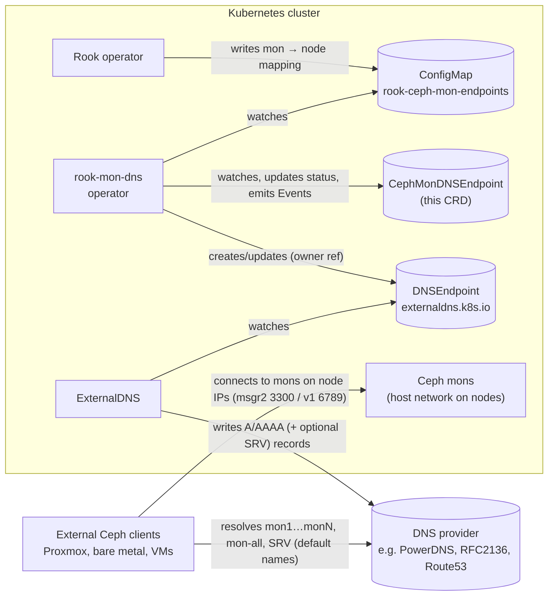

# rook-mon-dns

A Kubernetes operator that watches the Rook Ceph `rook-ceph-mon-endpoints`
ConfigMap and publishes the monitor **node IPs** as DNS records via
[ExternalDNS](https://github.com/kubernetes-sigs/external-dns) `DNSEndpoint`
objects. This makes the Ceph monitors reachable by name for clients outside
the cluster (e.g. Proxmox, bare-metal hosts, VMs).

> [!WARNING]
> **Alpha – use at your own risk.** Tested with unit, envtest and kind e2e
> tests and on one real cluster (see [Tested setup](#tested-setup)), but not
> yet in wider production use. The API (`v1alpha1`) may change without a
> migration path. Test it in a non-critical environment first; no warranty
> of any kind (see the license).
>
> **AI-assisted:** Large parts of the code, tests and documentation were
> written with the help of AI coding assistants and reviewed by a human.
>
> This is an independent community project. It is not affiliated with or
> endorsed by the Rook project, Ceph or the CNCF.

## Why

If you run a central Rook Ceph cluster that is mounted from outside
Kubernetes (e.g. ceph-csi in other clusters, Proxmox, kernel or ceph-fuse
mounts), the clients need a mon address to connect to. With host networking
the mons listen on node IPs, and when Rook fails a mon over to another node,
it comes back with a different IP. Rook records the current addresses only
inside the cluster, in the `rook-ceph-mon-endpoints` ConfigMap; nothing
outside Kubernetes is told about the change. A client only needs to reach
one mon on the first connect; that mon returns the current monmap with the
addresses of all others. A Service, load balancer or Ingress doesn't help: Ceph doesn't speak
HTTP, and clients connect directly to the addresses in the monmap. So this
project publishes the current mon IPs under stable DNS names.

## How it works



The operator only talks to the Kubernetes API server: it never contacts your
DNS provider or Ceph directly. ExternalDNS does the actual DNS update.

Rook stores the mon endpoints in the `rook-ceph-mon-endpoints` ConfigMap: the
`data` field lists each mon's IP and port, the `mapping` field the node each
mon runs on with its node IP. With `hostNetwork` both IPs are the same and
reachable from outside the cluster. The operator parses the mapping, sorts the
mons by ID and publishes:

| Record | Type | Content |
|---|---|---|
| `mon1.<zone>` … `monN.<zone>` | A/AAAA | one record per mon, sorted by mon ID |
| `mon-all.<zone>` | A/AAAA | all mon node IPs in one record (round-robin) |
| `_ceph-mon._tcp.<zone>` | SRV | optional, for Ceph client discovery via `mon dns srv name`; port per mon from the ConfigMap (6789 or 3300) |

When a mon is replaced, the numbering of the other mons can shift, so point
clients at `mon-all` or the SRV record (see [design notes](docs/design.md)).

The records are written into a single `DNSEndpoint` object per
`CephMonDNSEndpoint` resource; ExternalDNS picks it up from there.

## Prerequisites

1. **Rook Ceph cluster with `hostNetwork: true`** – without host networking
   the mons listen on ClusterIPs that are not reachable from outside. The
   operator detects this (`HostNetworkRequired`) and publishes nothing.
2. **DNSEndpoint CRD installed:**
   ```sh
   kubectl apply -f https://raw.githubusercontent.com/kubernetes-sigs/external-dns/master/config/crd/standard/dnsendpoints.externaldns.k8s.io.yaml
   ```
3. **ExternalDNS configured for `DNSEndpoint` objects.** The defaults are not
   enough:
   - `--source=crd` (in addition to e.g. `service`/`ingress`), otherwise the
     `DNSEndpoint` objects are ignored and no records appear;
   - `--managed-record-types=SRV` (repeat the flag for `A`, `AAAA`, `CNAME`)
     if you enable the SRV record; by default ExternalDNS only manages
     A, AAAA and CNAME;
   - RBAC: `get`/`list`/`watch` on `dnsendpoints` and `update` on
     `dnsendpoints/status` (group `externaldns.k8s.io`);
   - the TXT registry (so it owns and cleans up the records) and a
     `--domain-filter` that covers your zone.

   With the official ExternalDNS Helm chart, which also creates the RBAC:
   ```yaml
   sources: [service, ingress, crd]
   managedRecordTypes: [A, AAAA, CNAME, SRV]
   ```

The operator needs no access to your DNS provider – ExternalDNS handles that.

## Installation

Images: `ghcr.io/rook-mon-dns/rook-mon-dns:<version>` (amd64 and arm64), see
[Releases](https://github.com/rook-mon-dns/rook-mon-dns/releases). CI also
publishes `:main` and `:sha-<commit>` for every commit on `main`.

### Kustomize

```sh
# deploys into the rook-ceph namespace, watching only that namespace
kubectl apply -k "github.com/rook-mon-dns/rook-mon-dns/config/default?ref=v0.1.0"
```

Or apply the `install.yaml` attached to the release. To build your own image:
`make docker-build docker-push deploy IMG=<registry>/rook-mon-dns:<tag>`.

Then create a `CephMonDNSEndpoint` as shown under [Configuration](#configuration).

### Helm

```sh
helm install rook-mon-dns oci://ghcr.io/rook-mon-dns/charts/rook-mon-dns \
  --version 0.1.0 \
  --namespace rook-ceph \
  --set "allowedZones={ceph.example.com}"
```

The chart deploys the image matching its `appVersion` unless `image.tag` is set.

Interesting values (see `values.yaml`): `watchNamespaces` (one Role/RoleBinding
per namespace), `allowedZones`, `networkPolicy.*`, `metrics.enabled`.

## Tested setup

Verified on a real cluster: Rook Ceph with `hostNetwork: true` (3 mons,
msgr2 only, port 3300), Cilium with the chart's NetworkPolicies enabled,
ExternalDNS with the PowerDNS provider. Output below with zone and IPs
replaced by documentation values:

```console
$ kubectl -n rook-ceph get cmde
NAME        READY   ZONE              AGE
rook-ceph   True    ceph.example.com  10s

$ kubectl -n rook-ceph get events --field-selector involvedObject.kind=CephMonDNSEndpoint
LAST SEEN   TYPE     REASON   OBJECT                         MESSAGE
10s         Normal   Synced   cephmondnsendpoint/rook-ceph   Published 5 DNS records in zone ceph.example.com

$ dig +short mon1.ceph.example.com
192.0.2.15
$ dig +short mon-all.ceph.example.com
192.0.2.18
192.0.2.15
192.0.2.11
$ dig +short SRV _ceph-mon._tcp.ceph.example.com
0 10 3300 mon2.ceph.example.com.
0 10 3300 mon3.ceph.example.com.
0 10 3300 mon1.ceph.example.com.
```

A CR with a zone outside `allowedZones` was rejected (`ZoneNotAllowed`) and
no `DNSEndpoint` was created. From a host outside the cluster,
`mon-all.ceph.example.com:3300` was reachable and all three mons answered the
Ceph client.

## Configuration

```yaml
apiVersion: rook-mon-dns.github.io/v1alpha1
kind: CephMonDNSEndpoint
metadata:
  name: rook-ceph
  namespace: rook-ceph
spec:
  zone: ceph.example.com        # required; base zone for all records
  # recordTemplate: "mon{n}"    # {n}=sequence number, {id}=mon ID
  # allRecordName: "mon-all"    # "" disables the aggregate record
  # ttl: 300
  # srv:
  #   enabled: false            # _ceph-mon._tcp.<zone> SRV record
```

Operator flags: `--watch-namespaces` (restrict cache + RBAC scope),
`--allowed-zones` (restrict which `spec.zone` values are accepted).

The operator is read-only towards Rook and carries namespace-scoped RBAC only
(Roles, no ClusterRole at runtime). Deleting a `CephMonDNSEndpoint` removes
its `DNSEndpoint` (owner reference), and ExternalDNS removes the DNS records.

**Recommended: set `--allowed-zones` (`allowedZones` in Helm).** By default it
is empty, and the operator accepts any zone. Then anyone who can create a
`CephMonDNSEndpoint` and a ConfigMap in a watched namespace can publish A
records with arbitrary IPs in every zone your ExternalDNS manages. The Kustomize
deployment does not set the flag; add it to the manager args in a patch.

## Development

Requirements: Go (version in `go.mod`), make, Docker and
[kind](https://kind.sigs.k8s.io/) for the e2e tests. Other tools (controller-gen,
kustomize, envtest, golangci-lint) are downloaded into `bin/` by `make`. With
Nix, `nix-shell` provides everything.

```sh
make test               # unit + envtest integration tests
make test-e2e           # end-to-end tests in a throwaway kind cluster
make lint               # golangci-lint
make run                # run locally against your current kubeconfig
make manifests generate # regenerate CRDs/RBAC/deepcopy after type changes
```

## Status conditions

Except for `ZoneNotAllowed`, a `Ready=False` reason keeps the previously
published records, so a briefly broken ConfigMap does not take down mon DNS.

| Reason | Meaning |
|---|---|
| `Synced` | DNS records are in sync with the ConfigMap |
| `ConfigMapNotFound` | source ConfigMap missing (retries every minute) |
| `MappingEmpty` | the ConfigMap has no node mapping (mons not pinned to nodes) |
| `MappingInvalid` | mapping field could not be parsed |
| `HostNetworkRequired` | mon IPs differ from the node IPs: the mons are not on the host network |
| `RecordNameConflict` | two records would get the same name (e.g. `allRecordName: mon1`) |
| `DNSEndpointConflict` | a `DNSEndpoint` with the CR's name exists and belongs to someone else |
| `ZoneNotAllowed` | zone not in `--allowed-zones`; the records are removed |

## License

Copyright 2026 The rook-mon-dns Authors.

Licensed under the [Apache License, Version 2.0](LICENSE). Distributed on an
"AS IS" BASIS, WITHOUT WARRANTIES OR CONDITIONS OF ANY KIND.
